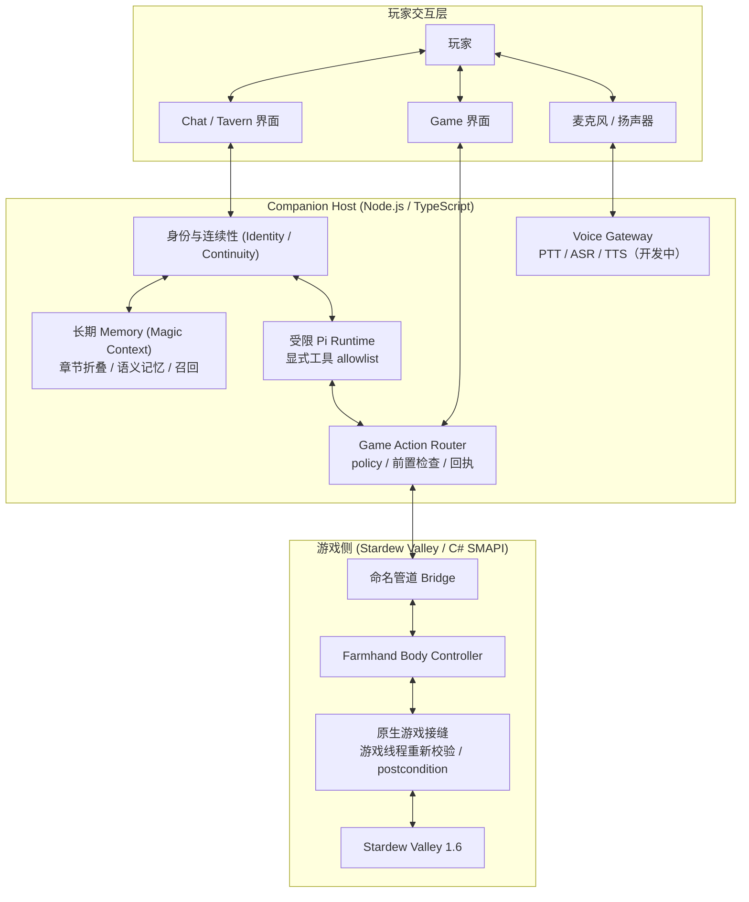

<div align="center">

# 🎮 GameBuddy

**AIRP for all — 一个跨越 Chat 与 Game 的长期 AI 角色伴侣**

*不是浮在游戏画面上的聊天窗，而是一个有连续身份、记得共同经历、并能沿着受约束的原生游戏接口真正行动的开源角色伴侣。*

[](LICENSE)
[](#-安装)
[](https://www.stardewvalley.net/)
[](https://smapi.io/)
[](https://nodejs.org/)
[](https://pnpm.io/)

> Node.js 与 pnpm 是从源码开发/构建要求；玩家使用自包含安装包时不需要预装它们。

[为什么](#-为什么是-gamebuddy) • [能力边界](#-当前能力边界) • [安装](#-安装) • [从源码运行](#-从源码运行) • [架构](#-架构) • [路线图](#-路线图) • [致谢](#-致敬与参考)

</div>

---

## 💡 为什么是 GameBuddy

大多数 AI 游戏助手只是一个**浮在画面上的通用聊天窗**：看不懂游戏内部状态，不能在游戏里真正行动，也无法把一次对话延续成一段关系。

GameBuddy 围绕 **AIRP（AI Role-Play）长会话**来搭建：角色不是某次会话里的临时人设，而是一个在 Chat 与 Game 之间持续存在的身份。

1. **一个连续身份，不是两个互不相干的产品。**
   Chat 与 Game 可以同时运行、各自启停、互不接管。绑定同一 continuity 时，它们共享同一份身份与受治理的长期 Memory；原始聊天记录、实时游戏状态、执行能力和行动回执始终各自独立。

2. **真实具身，不是画面外的建议。**
   在《星露谷物语》中，伴侣以原生 Farmhand 身份进入世界：真实的碰撞、寻路、工具与农务操作。每个会改变世界的动作都在游戏线程重新校验 scope、policy、revision、deadline 与实时前置条件，并在执行后给出 action-owned receipt、evidence 和 fresh postcondition。

3. **长会话是一等公民。**
   STOP 与 `/redirect` 是带 epoch 的显式控制；未知结果不会被伪装成成功或盲目重放；AI 崩溃、controller EOF 和普通关闭不会杀死玩家的游戏世界；重连必须经过 fresh authentication 与观察同步，恢复期间状态可见、动作保持暂停。

4. **酒馆级的角色表达。**
   兼容 SillyTavern 角色卡、世界书与开场白；对话与当下游戏事件相连，而不是各说各话。

5. **安全默认值写在架构里，而不是写在提示词里。**
   伴侣运行时以显式 allowlist 启动，不继承 Shell、文件、Git 或网络工具；游戏侧只暴露显式注册并经过审计的 typed Game Action，Host 不能凭模型文本扩大权限。

---

## 🧭 当前能力边界

首个、也是当前唯一正式支持的游戏集成是 **Stardew Valley 1.6 + SMAPI 4.x（Windows x64）**。“AIRP for all”指同一个长期角色跨越产品表面，不代表已支持所有游戏。

| 能力 | 状态 |
| :--- | :--- |
| Stardew 原生 Farmhand（碰撞、寻路、工具、农务） | ✅ 首个正式集成 |
| Typed Game Action + receipt / evidence / fresh postcondition | ✅ |
| Chat：角色卡、伙伴管理、会话、草稿保持 | ✅ |
| 世界书：条目管理与绑定 | 🚧 管理能力存在；selective Lorebook 仍是独立 release-candidate |
| 长期 Memory：章节折叠、语义记忆、跨会话召回 | ✅ |
| 跨表面连续性（Chat ↔ Game 同一身份） | ✅ 绑定同一 continuity 时 |
| 语音（PTT / ASR / TTS） | 🚧 开发中：ASR 与 TTS 仍在推进，不作为独立产品表面 |
| Windows 安装包（per-user、免 Node/.NET 运行时） | ✅ 安装到首次 authenticated action（同一 lineage terminal receipt）路径已验收；签名公开发行与自动更新仍在收敛 |
| 多游戏 / 社区 Connector | ⬜ 尚未支持（Host 已留 integration seam，但不是通用游戏协议） |
| macOS / Linux | ⬜ 尚未支持 |

模型由玩家自备：GameBuddy 不提供自己的模型端点。首次启动时在「设置 → 连接与模型」中接入你自己的 provider 与 API key。

---

## 📦 安装

### 玩家安装（Windows 10 / 11 x64）

安装包是 per-user、自包含的：不要求本机装有 Node、.NET 或本仓库副本。

1. 运行 `GameBuddy.Setup.exe`，按向导完成安装。
2. 启动 GameBuddy，在「游戏安装」中选择你的《星露谷物语》文件夹。
3. 如果该文件夹还没有 SMAPI，请先从 [SMAPI](https://smapi.io/) 安装；SMAPI 属于它自己的项目，GameBuddy 不附带或替换它。随后让 GameBuddy 检测并部署伴侣 Mod。
4. 在「设置 → 连接与模型」中填入你自己的 provider、模型与 API key。
5. 按「与伙伴一起玩」启动游戏会话；如果存档里还没有可用小屋，按提示选择一间。

完整的首次运行、数据位置、卸载与排障说明见 **[玩家安装与首次运行](guides/player-install.md)**。安装器 → 自定义 Stardew 路径 → Mod 部署 → 首次 authenticated action（同一 lineage terminal receipt）的玩家路径已验收；对应的阶段入口见 [`run-stardew-lifecycle-cold-session.mjs`](tools/run-stardew-lifecycle-cold-session.mjs)。

> 当前公开渠道的签名安装包与自动更新仍在收敛；在它开放之前，可以用下面的命令构建本地预览安装包。预览包未签名，Windows SmartScreen 可能提示，不用于分发。

### 构建本地安装包

```bash
pnpm install
pnpm build
pnpm build:player-distribution
# 产物：desktop/dist/setup/GameBuddy.Setup.exe
```

干净机安装验收（可选，需要 Windows Sandbox）：

```bash
pnpm run:sandbox-level3 -- --setup desktop/dist/setup/GameBuddy.Setup.exe
```

---

## 🛠️ 从源码运行

适合想改代码、跑测试或做游戏集成的贡献者。

### 环境要求

- Windows 10 / 11 (x64)
- Node.js `>= 24.13.0 < 25`
- pnpm `>= 11.1.3 < 12`
- .NET 8 SDK（构建桌面外壳与 Stardew Mod）
- 《星露谷物语》1.6.x + SMAPI 4.5+

### 常用命令

```bash
pnpm install

# 构建语音协议、Host 与前端
pnpm build

# 桌面外壳 / 安装包
pnpm build:desktop-launcher
pnpm build:player-distribution

# 质量门禁（格式、lint、类型、边界、C# 核心与集成测试）
pnpm quality:check
```

更细的开发流程、测试调用方式、live-run 与沙盒工具索引，见 **[开发指南](guides/development.md)**；提交与评审约定见 **[CONTRIBUTING.md](CONTRIBUTING.md)**。

---

## 🏛️ 架构



三条不变量让“陪伴”不等于“放手让模型操作电脑”：

- **游戏世界拥有最终权威。** 前置条件、执行结果与 postcondition 都由游戏侧给出；Host 只做受限投影，不能铸造权限或伪造完成。
- **未知副作用不重放。** 只有游戏权威确认“未被接受”时才允许重送同一请求；超时与断线走 receipt-backed recovery，而不是换一个身份重试。
- **恢复是可见状态，不是静默修复。** 断线、暂停和需要重新观察时，界面显示权威状态与下一步；不会假装任务仍在进行。

---

## 🧩 代码库结构

```text
ai-game-companion/
├── host/                  # Companion Host：身份、Memory、Pi runtime、Game Action 路由
├── dialogue-web/          # 产品界面：Chat / Tavern / Game 组合表面
├── integrations/stardew/  # C# SMAPI Mod：Farmhand 具身、typed actions、原生校验
├── packages/              # 共享契约（如 Game Action Program 模型与校验器）
├── protocol/              # 跨语言 Bridge 协议与 schema
├── desktop/               # Windows 桌面外壳与安装器
├── voice-gateway/         # 本地语音网关（PTT / ASR / TTS，开发中）
├── vendor/
│   ├── pi-koe/            # 第一方语音中枢（submodule）
│   └── magic-context/     # 长期 Memory 引擎（定制 fork）
├── assets/tavern/         # 角色卡与提示词预设
├── fixtures/              # 场景、角色卡与协议验证样本
├── tools/                 # 门禁、live-run、沙盒与诊断工具
└── guides/                # 玩家安装与开发文档
```

---

## 🗺️ 路线图

- [x] **Stardew 具身与可信行动（能力层）**
  - [x] 命名管道 Bridge、Farmhand 生命周期与原生行动
  - [x] 游戏线程重新校验、action-owned receipt / evidence / postcondition
  - [x] 执行恢复：同一 lineage 查询、未知结果不重放、跨日继续
- [x] **Chat 与长期角色**
  - [x] SillyTavern 角色卡、世界书、开场白与伙伴管理
  - [x] 长期 Memory 章节折叠与语义记忆
  - [x] Chat / Game 共享 continuity 的跨表面连续性
- [ ] **发布收敛**
  - [ ] 签名公开发行通道与自动更新
  - [x] 安装 → 自定义路径识别 → 部署 Mod → 首次 authenticated action（同一 lineage terminal receipt）的玩家旅程验收
  - [ ] 关闭、游戏存活、重新 attachment 与 fresh observation sync 的完整玩家尾段验收
  - [ ] 语音链路：ASR / TTS、设备路径与完整语音体验验收
- [ ] **生态**
  - [ ] 社区游戏 Connector
  - [ ] 跨游戏的通用 Companion Protocol

---

## 💖 致敬与参考

- **[SillyTavern](https://github.com/SillyTavern/SillyTavern)**：角色卡（Character Cards V2）、世界书与人设引导的业界标杆。GameBuddy 借鉴了它的表达规范，并把这份沉浸感延伸到真实游戏世界。
- **[AIRI](https://github.com/moeru-ai/airi)**：AI 角色在场感与跨平台分发的先行者。GameBuddy 走的是另一条互补路线：让长期角色身份接入真实世界状态与可验证行动。
- **[Pi Coding-Agent SDK](https://github.com/earendil-works/pi)**：受限智能体宿主运行时，负责会话状态机、工具派发与流式通讯。
- **[CortexKit Magic Context](https://github.com/cortexkit/magic-context)**：本地 SQLite 长期记忆、章节折叠与情境召回。
- **[SMAPI](https://smapi.io/)** 与 Stardew Modding 社区：让原生具身成为可能。
- **[CharacterHub / Chub AI](https://chub.ai/)** 与角色卡创作者社区：默认伴侣「琥珀（Kohaku）」遵循 CCv2 规范，面向具身陪伴设计。

---

## 📄 许可证

核心源代码使用 **[GNU Affero General Public License v3.0 (AGPL-3.0)](LICENSE)**。

- 核心框架与服务（`host`、`dialogue-web`、`integrations`、`desktop`、`packages`）：AGPL-3.0。
- 官方角色预设（`assets/tavern/presets/default-companion`）：CC0-1.0，详见该目录的 `ATTRIBUTION.md`；第三方导入内容遵循其原始授权。

请不要在 Issue、日志或截图中提交 API key、角色卡私密内容或完整游戏存档。
