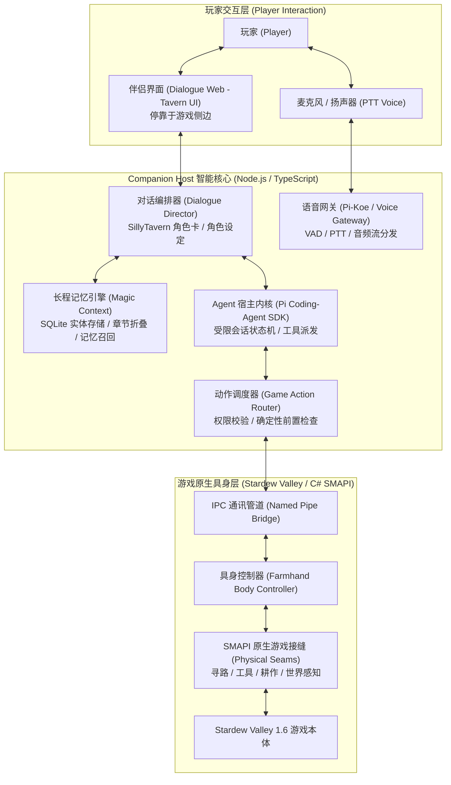

<div align="center">

# 🎮 GameBuddy

**Next-Generation Embodied AI Game Companion**  
*与你并肩游玩、自然交谈、具身于游戏世界的下一代开源 AI 游戏伴侣*

[](LICENSE)
[](https://nodejs.org/)
[](https://pnpm.io/)
[](https://dotnet.microsoft.com/)
[](https://www.stardewvalley.net/)
[](https://smapi.io/)

[特性亮点](#-特性亮点) • [致敬与灵感](#-致敬与参考-acknowledgements) • [系统架构](#-系统架构) • [模块结构](#-代码库结构) • [快速开始](#-快速开始) • [开发路线](#-开发路线-roadmap) • [许可证](#-许可证)

</div>

---

## 💡 为什么是 GameBuddy？

现有的各类 AI 游戏助手往往只是一个**浮在游戏画面上的通用聊天浮窗**：它们看不懂游戏内部状态、无法在游戏里真正行动，更无法与玩家产生真正的“并肩冒险”羁绊。

**GameBuddy 的核心突破是“具身化（Embodied Agency）”与“酒馆级情感互动（Tavern-Style RP）”的深度融合：**
1. **真正的游戏身体**：AI 不再是悬浮聊天窗，而是通过原生游戏模组作为正式玩家（如星露谷物语中的真实 Farmhand）踏入游戏世界，拥有真实的物理碰撞、自主寻路、工具使用与农务操作能力；
2. **酒馆级人设与沉浸感**：深度借鉴并兼容 **SillyTavern（酒馆）** 角色卡与对话机制，具备丰富的情感表达、开场白分支与记忆沉浸，且所有对话都与当下游戏事件紧密相连；
3. **全双工实时语音交互**：支持低延迟 PTT（Push-To-Talk）、语音打断与流式语音合成，让玩家在游玩过程中无需切出打字，像与真人联机好友一般自然交谈。

---

## ✨ 特性亮点

### 🚜 1. 具身游戏智能 (Embodied In-Game Agent)
* **原生游戏引擎接缝**：以《星露谷物语》（Stardew Valley 1.6 + SMAPI）为首个落地范例，AI 伴侣以正式受控 Farmhand 身份加入。
* **物理行动与感知**：具备自主 A* 寻路（`travel`）、农田耕作（`till_soil`）、工具装备（`equip_tool`）、道具交互等真实行动力。
* **严格的状态机与收据回执**：告别大模型的幻觉式操作。每次操作均通过 C# 原生接缝进行前置校验与后置权威验证（Receipt Verification），确保游戏进度安全可靠。

### 🎭 2. 酒馆级角色与对话系统 (Tavern-Inspired Engine)
* **深度兼容 SillyTavern 规范**：支持角色卡（Character Cards）、世界书（Lorebooks）、多变体开场白与人设指令注入。
* **双向情境感知（Bi-directional Awareness）**：伴侣不仅能陪你闲聊，还能实时感知游戏事件（“体力耗尽了”、“下雨了”、“农作物成熟了”），并在对话中主动关切或庆祝。
* **游戏伴生 UI (`dialogue-web`)**：专为游戏并肩场景设计的极简侧边栏界面，支持紧凑停靠、立绘情绪反馈、实时思绪气泡与操作回执展示。

### 🎙️ 3. 全双工低延迟语音网关 (Voice Gateway)
* **流畅语音对话**：专为游戏场景定制的低延迟音频通道，支持按键通话（PTT）与流式端点检测（VAD）。
* **智能打断与取消**：玩家开麦说话时自动打断伴侣当前的朗读，保证对话自然不冲突。
* **高表现力 TTS**：接入先进的流式拟真语音引擎（如 MiMo TTS、EdgeTTS），伴随游戏情绪动态变化声调。

### 🛡️ 4. 严格确定的安全与权限防线
* **Fail-Closed 架构**：伴侣宿主（Companion Host）与游戏内部隔离，只能执行显式注册并经过安全审计的 `Game Action`，绝不向大模型暴露任意文件系统或底层 Shell 权限。

---

## 🏛️ 系统架构



---

## 🧩 核心技术栈与开源基座 (Core Technology Stack)

GameBuddy 采用分层解耦的工程体系，核心能力由以下坚固底座支撑：

| 组件 / 依赖 | 源码与归属 | 职责与在项目中的角色 |
| :--- | :--- | :--- |
| **Pi Coding-Agent SDK** | `@earendil-works/pi-coding-agent`<br>(底层智能体 SDK) | **智能体宿主运行时**。驱动受限的 Companion Session 状态机、工具派发与模型流式通讯，提供严格隔离的沙盒执行环境。 |
| **Magic Context** | `@cortexkit/pi-magic-context`<br>(`vendor/magic-context`) | **长程记忆与上下文折叠引擎**。基于本地 SQLite 实现自动分章归档（Historian）、实体记忆管理以及世界书条目（WorldBook）的动态召回，杜绝多轮游玩的上下文爆炸。 |
| **Pi-Koe** | `vendor/pi-koe`<br>(**第一方自研 Submodule**) | **伴侣原生语音中枢**。针对游戏交互场景研发的低延迟语音中枢（开源项目 `zhexulong/pi-koe`），提供按键通话（PTT）状态机、流式语音输出与打断流控。 |
| **SMAPI 4.x & .NET 8** | `Pathoschild.Stardew.ModBuildConfig`<br>(开源社区) | **游戏原生模组构建管线**。负责构建将 AI 实体挂载进《星露谷物语》的 C# 原生二进制插件与事件钩子。 |

---

## 📂 代码库结构

```text
ai-game-companion/
├── host/                  # Companion Host 智能核心：基于 Pi SDK 与 Magic Context 驱动
├── dialogue-web/          # 伴侣前端界面：紧凑停靠式侧边栏、酒馆角色卡交互、聊天流
├── integrations/
│   └── stardew/           # C# SMAPI 原生游戏模组：Farmhand 具身控制、动作执行、游戏感知
├── packages/              # 共享领域包 (例如 game-action-program 动作契约与校验器)
├── protocol/              # 跨语言通讯协议：IPC 命名管道契约与 Schema 描述
├── desktop/               # Windows 桌面宿主外壳：侧边停靠、生命周期守护与进程协调
├── vendor/
│   ├── pi-koe/            # [第一方 Submodule] 自研 Pi 原生低延迟语音中枢 (zhexulong/pi-koe)
│   └── magic-context/     # [定制 Fork] CortexKit 长程记忆引擎分支 (@cortexkit/pi-magic-context)
├── assets/
│   └── tavern/presets/    # 预设的伴侣角色卡与提示词模版 (SillyTavern 兼容)
├── fixtures/              # 测试基准集：包含场景回放、角色卡与协议验证样本
└── tools/                 # 自动化工程门禁、状态机审计与端到端验证工具链
```

---

## 🚀 快速开始

### 1. 环境准备
确保本机已安装以下基线环境：
* **操作系统**：Windows 10 / 11 (x64)
* **Node.js**：`>= 24.13.0`
* **包管理器**：`pnpm >= 11.1.3`
* **.NET SDK**：`.NET 8.0 SDK`
* **游戏环境**：《星露谷物语》(Stardew Valley 1.6.x) + [SMAPI 4.5+](https://smapi.io/)

### 2. 克隆与安装

```bash
git clone https://github.com/zhexulong/gamebuddy.git
cd gamebuddy

# 安装依赖
pnpm install
```

### 3. 构建项目

```bash
# 构建全部模块 (Host, Dialogue Web, Voice Protocol)
pnpm build

# 运行代码规范与端到端质量门禁
pnpm quality:check
```

### 4. 运行伴侣界面

```bash
# 启动伴侣网页端
pnpm --filter @gamebuddy/dialogue-web dev

# 启动伴侣核心宿主
pnpm --filter @gamebuddy/companion-host start
```

---

## 🗺️ 开发路线 (Roadmap)

- [x] **Phase 1: 具身游戏接缝**
  - [x] SMAPI Named-Pipe 双向低延迟通讯通道
  - [x] Farmhand 原生身体接入与生命周期同步
  - [x] 核心游戏动作实现：寻路导航 (`travel`)、农务耕作 (`till_soil`)、装备切换 (`equip_tool`)
- [x] **Phase 2: 酒馆级对话与界面**
  - [x] 兼容 SillyTavern 角色卡与分支开场白机制
  - [x] 紧凑停靠式伴侣 Web UI（支持立绘、状态指示、动作实时气泡）
  - [x] 游戏事件驱动的主动对话触发器
- [ ] **Phase 3: 即时语音交互与音画同步**
  - [x] PTT 按键流控与状态机
  - [x] 流式 TTS 语音输出与动态打断
  - [ ] 实时语音输入链路与文字降级通道
- [ ] **Phase 4: 多游戏通用生态**
  - [ ] 跨游戏通用的 Companion Protocol 抽象
  - [ ] 本地长期情境记忆与情感图谱演进

---

## 💖 致敬与参考 (Acknowledgements)

GameBuddy 的诞生深受以下杰出开源项目、社区与创作者的启发，在此致以诚挚敬意：

* **[SillyTavern (酒馆)](https://github.com/SillyTavern/SillyTavern)**：业界标杆级的 LLM 角色扮演前端。GameBuddy 在角色卡协议规范（Character Cards V2）、世界书（WorldBook / Lorebook）机制、人设引导和酒馆对话美学上深度借鉴了 SillyTavern 的设计，旨在将酒馆的沉浸感从纯文本对话扩展到具备游戏实体的交互维度。
* **[CharacterHub / Chub AI](https://chub.ai/) 与类脑社区**：丰富的开源角色卡创作者生态与理论研究。GameBuddy 默认内置原创全年龄标杆伴侣「琥珀（Kohaku）」，其人设遵循酒馆 CCv2 规范与多层性格引擎架构，专为星露谷具身陪伴打造。
* **[Pi Coding-Agent SDK](https://github.com/earendil-works/pi)** & **[CortexKit (Magic Context)](https://github.com/cortexkit/magic-context)**：感谢 Pi 团队构建的精悍智能体宿主运行时，以及 CortexKit 打造的基于本地 SQLite 章节折叠、实体记忆与情境召回的 Magic Context 记忆引擎，为游戏伴侣的长程连续性提供了坚实基座。
* **开源大模型社区**：感谢开源模型社区为游戏伴侣的端到端思考与语言生成提供的坚实支持。

---

## 📄 许可证 (License)

本项目核心源代码基于 **[GNU Affero General Public License v3.0 (AGPL-3.0)](LICENSE)** 协议开源。

* **核心框架与服务** (`host`, `dialogue-web`, `integrations`, `desktop`, `packages`): 遵循 AGPL-3.0 开源协议。
* **官方角色预设内容** (`assets/tavern/presets/default-companion`): 官方原创伴侣设定遵循 CC0-1.0 (Public Domain Dedication) 公共领域协议，详见对应目录下的 `ATTRIBUTION.md`。第三方用户自行导入的预设遵从各自原始授权。
